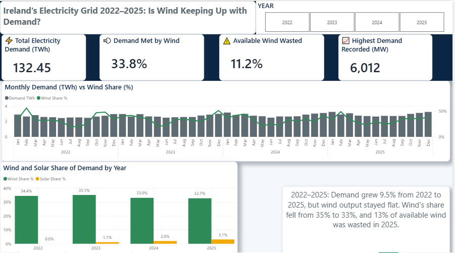
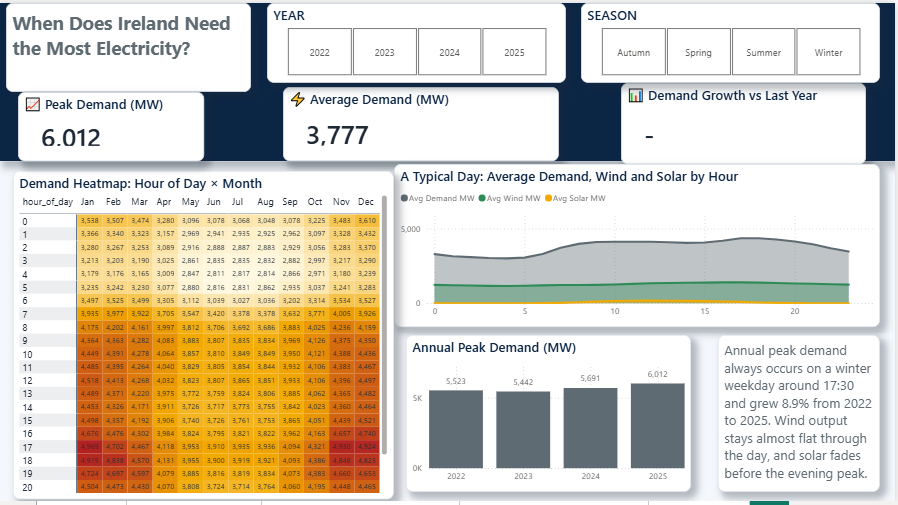
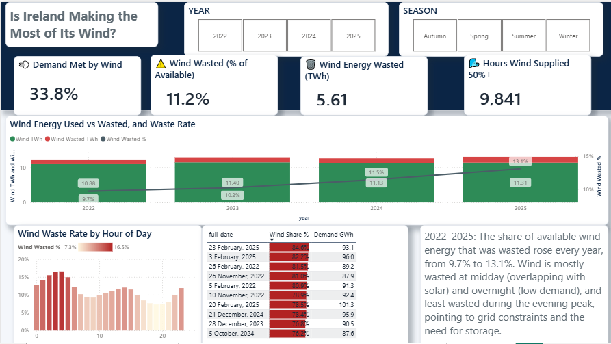
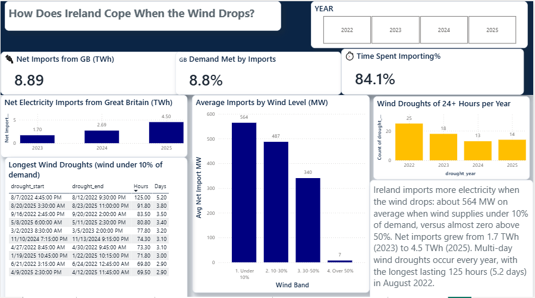

# ⚡ Ireland's Electricity Grid 2022–2025: Is Wind Keeping Up with Demand?

An end-to-end analytics project using **140,256 quarter-hourly records** of official EirGrid data to analyse electricity demand, wind and solar performance, wasted wind energy and imports in Ireland.

**Tools:** Python (Pandas) · MySQL · Power BI (DAX, star schema) · Google Colab



---

## 💡 Why I Built This

I want to use my data skills in Ireland's energy sector, so I wanted a project built on real Irish data instead of a tutorial dataset. I am studying for an MSc in Business Analytics in Dublin, and electricity is a topic that affects everyone here, from rising demand and data centres to new wind farms. My goal was to build a complete project on my own, from raw files to a finished dashboard, and answer one simple question: is wind keeping up with demand? The result that surprised me most was how much wind energy is wasted, more than 13% of available wind in 2025.

---

## 📌 Business Questions

1. How has electricity demand changed, and when does it peak?
2. What share of demand does wind supply, and is it keeping pace with demand growth?
3. How much available wind energy is wasted (dispatched down), and when?
4. How often does the wind drop, and for how long?
5. How does Ireland cope when the wind drops?

---

## 🔑 Key Findings

| # | Finding |
|---|---|
| 1 | **Demand grew 9.5%** from 31.6 TWh (2022) to 34.6 TWh (2025), and annual peak demand rose **8.9%** to 6,012 MW. |
| 2 | **Wind output stayed flat** (~11 TWh/year), so wind's share of demand **slipped from 35.1% (2023) to 32.7% (2025)**. Hours when wind supplied over half of demand fell **19%**. |
| 3 | **Peak demand always occurs on a winter weekday around 17:30**. In 2024 wind supplied only **7.9%** of demand at the peak moment, far below its ~33% annual average. |
| 4 | **Wasted wind rose every year**, from **9.7% to 13.1%** of available wind energy (1.17 → 1.71 TWh, +46%). Waste peaks at **13:00–14:00** (overlap with solar) and **03:00–04:00** (low demand), and is lowest during the **evening peak**. |
| 5 | **Multi-day wind droughts happen every year.** There were 70 periods of 24+ hours with wind under 10% of demand; the longest lasted **125 hours (5.2 days)** in August 2022. |
| 6 | **Imports from Great Britain rose from 1.7 TWh (2023) to 4.5 TWh (2025)**, from 5% to 13% of demand. Average imports were **564 MW** when wind was under 10% of demand, versus almost **zero** when wind was above 50%. |
| 7 | **Solar is growing fast from a small base**: from 0% to 3.1% of demand, with output up ~60% from 2024 to 2025. |

**The story:** Irish demand is growing faster than wind generation. More available wind is being wasted at midday and overnight, while calm, cold winter evenings are increasingly covered by imports. This points to the value of grid reinforcement, storage and demand shifting.

---

## 🏗️ Project Architecture

```
EirGrid Excel files  →  Python (clean & combine)  →  MySQL (star schema)  →  Power BI dashboard
   3 files, 4 years        140,256 rows, QA checks      fact + 2 dimensions     4 pages, 25+ DAX measures
```

---

## 📂 Repository Structure

```
irish-grid-renewables-analysis/
├── README.md
├── python/
│   └── clean_eirgrid_data.py        # Combine, clean, validate and export the data
├── sql/
│   ├── 01_create_staging.sql        # Database and staging table
│   ├── 02_load_data.sql             # LOAD DATA INFILE with NULL and boolean handling
│   ├── 03_build_star_schema.sql     # dim_date, dim_time, fact_grid_15min
│   ├── 04_data_checks.sql           # Validation queries
│   ├── 05_analysis_queries.sql      # 10 business questions with written findings
│   └── 06_create_views.sql          # Wind drought view (gaps-and-islands)
├── powerbi/
│   └── irish_grid_dashboard.pbix
├── notebooks/
│   └── 02_data_cleaning.ipynb
└── images/                          # Dashboard screenshots
```

---

## 📊 Data Source

- **EirGrid System and Renewable Data Reports**, quarter-hourly system data for 2022–2025:
  https://www.eirgrid.ie/grid/system-and-renewable-data-reports
- Data provided by EirGrid Group under its open data licence.
- Scope: **Republic of Ireland (IE)** columns only, 1 January 2022 to 31 December 2025.

The raw data is not included in this repository. Download the files from the link above into `data/raw/` to reproduce the project.

---

## 🧹 Data Cleaning Decisions

| Issue | Decision |
|---|---|
| **Daylight saving time**: a missing hour each March and a repeated hour each October | Converted all timestamps to **UTC** using EirGrid's GMT Offset column, giving a complete timeline with no gaps or duplicates |
| **Power vs energy**: data is in MW at 15-minute intervals | Energy calculated as **MWh = MW × 0.25** |
| **Greenlink interconnector**: blank before 29 Jan 2025 | Set to **0**, because the interconnector was not yet operating |
| **EWIC interconnector**: blank for all of 2022 | Kept as **NULL** (data not published, not zero flow); import analysis starts in 2023 |
| **Solar**: reporting began April 2023 | Earlier values are 0 by definition |
| **Wind generation slightly above availability** in under 1% of rows (median ~12 MW) | Treated as estimation noise in EirGrid's availability figure; dispatch-down set to 0 for these rows |
| **Floating-point noise** | Values rounded before loading to SQL (zero load warnings) |

---

## 🗄️ SQL Highlights

- **Star schema**: `fact_grid_15min` (140,256 rows), `dim_date` (1,461 days), `dim_time` (96 slots)
- **Window functions**: `LAG()` for year-on-year comparisons, `ROW_NUMBER()` and `RANK()` for peaks and record days
- **Gaps-and-islands technique** to detect continuous wind droughts, saved as a view for Power BI
- Conditional aggregation, CTEs and `NULLIF` handling during `LOAD DATA INFILE`

---

## 📈 Power BI Dashboard

| Page | Focus |
|---|---|
| **1. Overview** | KPIs, monthly demand vs wind share, wind and solar share by year |
| **2. Demand Patterns** | Typical daily profile by season, hour × month heatmap, annual peaks |
| **3. Wind Performance** | Wind used vs wasted, waste rate by hour, top 10 windiest days |
| **4. Imports and Droughts** | Net imports, imports by wind level, wind droughts per year, longest wind droughts |

**DAX highlights:**
- Ratio measures with `DIVIDE` that stay correct at every level (year, month, total)
- Year-on-year measures guarded with `HASONEVALUE` to avoid misleading multi-year comparisons
- `RANKX` with `ALLSELECTED` for slicer-aware Top 10 rankings
- Measures that exclude missing interconnector data from the denominator

| Overview | Demand Patterns |
|---|---|
|  |  |

| Wind Performance | Imports and Droughts |
|---|---|
|  |  |

---

## ✅ Validation

Annual totals were checked to match across **Python, MySQL and Power BI**:

| Year | Demand (TWh) | Wind share | Solar share | Peak (MW) | Wind wasted |
|---|---|---|---|---|---|
| 2022 | 31.62 | 34.4% | 0.0% | 5,523 | 9.7% |
| 2023 | 32.50 | 35.1% | 1.1% | 5,442 | 10.2% |
| 2024 | 33.72 | 33.0% | 2.0% | 5,691 | 11.5% |
| 2025 | 34.61 | 32.7% | 3.1% | 6,012 | 13.1% |

---

## 🧩 Challenges and What I Learned

**1. Finding the right data**
- **Problem:** I first planned to download data from the EirGrid Smart Grid Dashboard, but it did not give me the data in the format I needed.
- **What I did:** I found EirGrid's official quarter-hourly system data files and checked each one for missing values, row counts and column changes before using it.
- **What I learned:** The first data source is not always the best one, and checking the data early saves time later.

**2. Connecting Power BI to MySQL**
- **Problem:** Power BI kept asking me to install extra components, even after I installed the latest MySQL Connector/NET.
- **What I did:** I found that Power BI only works with the 8.0.x version of the connector, not 9.x. I installed an 8.0.x version and the connection worked.
- **What I learned:** The newest version of a tool is not always the right one, and reading community forums helps to solve real problems.

**3. A wrong number on my dashboard**
- **Problem:** My Demand YoY % card showed 35.4% growth, which was far too high.
- **What I did:** I found that with all years selected, Power BI compared four years of data with only three years. I changed the measure with `HASONEVALUE` so it only calculates when one year is selected. I then checked the new result (+3.1% for winter 2025) against my SQL numbers.
- **What I learned:** Always ask if a number makes sense before trusting it.

**4. Testing my own idea**
- **Problem:** I thought solar power was the main reason wind energy was being wasted.
- **What I did:** I wrote a SQL query to check wasted wind by hour of day. Waste was high at midday, but almost as high at 3am, when there is no solar at all.
- **What I learned:** An idea is only a guess until the data supports it. The data pointed to grid constraints and low night demand as bigger causes.

---

## ⚠️ Limitations

- **Wasted wind** is calculated as availability minus generation. Availability is an EirGrid estimate, so figures may differ slightly from EirGrid's official dispatch-down reports.
- **Demand** is transmission-level system demand as reported by EirGrid.
- **Import analysis covers 2023–2025** only, because EWIC data is not available for 2022.
- **CO₂ intensity** is not included in the source files and is out of scope.

---

## ▶️ How to Reproduce

1. Download the quarter-hourly files from EirGrid into `data/raw/`.
2. Run `python python/clean_eirgrid_data.py` (requires `pandas` and `openpyxl`).
3. Copy the output CSV into MySQL's `secure_file_priv` folder and run the SQL scripts `01` to `06` in order.
4. Open `powerbi/irish_grid_dashboard.pbix` and update the MySQL connection (`localhost`, database `irish_grid`).

---

## 👤 Author

**Nouman Ahmad**, MSc Business Analytics, Dublin Business School
[LinkedIn](https://linkedin.com/in/noumangujjar)
